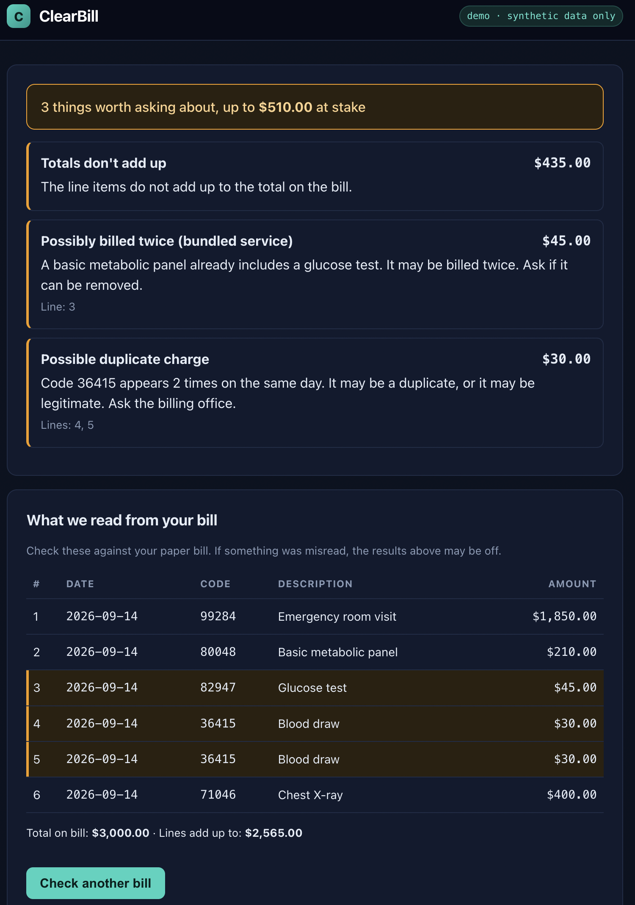

# Clearbill

# ClearBill

ClearBill helps people find charges on a medical bill that are worth questioning. Upload an itemized bill (a photo or a CSV) and it flags possible duplicate charges, totals that don't add up, and bundled services that may be billed twice.



> **Demo project.** It has only been tested on invented bills. It isn't medical, legal, or financial advice, and a flag is a question to ask a billing office, not proof of an error.

## How it works

1. **Reading the bill.** A CSV is parsed directly. A photo is read by a local vision model (Ollama, `qwen2.5vl:3b`) that returns structured line items.
2. **Validating.** The AI's output is never trusted. Plain code checks every date and amount before anything is saved.
3. **Auditing.** A rules engine written in plain Python (no AI) finds the issues, so detection is deterministic and unit tested.
4. **Showing.** A React + TypeScript frontend lists the flags, highlights the affected lines, and shows what was read from the bill so the user can verify it.

## Design decisions

- **AI only reads, rules decide.** Keeping flagging out of the model makes it testable and explainable.
- **Money is stored as integer cents.** This avoids floating-point rounding bugs.
- **Flags are computed on read.** Improving a rule improves results for old bills too.
- **SQLite for development.** SQLAlchemy lets it switch to Postgres through one setting.

## Tech stack

Python, FastAPI, SQLAlchemy, SQLite, pytest, React, TypeScript, Vite, Ollama

## Run it locally

Backend:

```bash
cd backend
python3 -m venv .venv
source .venv/bin/activate
pip install -r requirements.txt
python -m pytest
uvicorn app.main:app --reload
```

Frontend (in a second terminal):

```bash
cd frontend
npm install
npm run dev
```

Open http://localhost:5173 and click **Try a sample bill**.

Photo reading needs [Ollama](https://ollama.com) running with `ollama pull qwen2.5vl:3b`. CSV upload works without it.

## Limitations

- The unbundling check uses a small illustrative list, not the full Medicare (NCCI) edits.
- Photo reading uses a small local model and can misread text.
- Dates must be `MM/DD/YYYY` or `YYYY-MM-DD`.
- Works best on itemized bills with a code, date, and amount per line.

## Roadmap

- Plain-language explanations and translation for non-native English speakers
- Dispute letter drafts
- Accuracy measurements on a set of synthetic bills with planted errors
- A "delete my bill" option
- Deployment